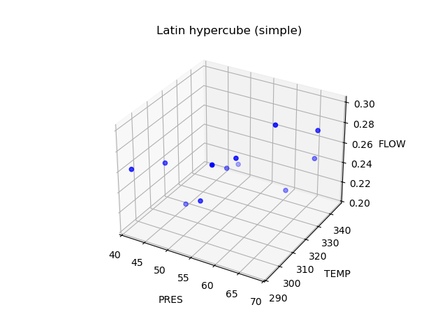

# NAME

doeify - Create Design of Experiment combinations from given parameter sets

# SYNOPSIS

**doeify** [-\-*OPTION*]

# DESCRIPTION

**doefiy** serves as a wrapper for the [Design of Experiment Generator in Python (DOEPY)](https://doepy.readthedocs.io/) authored and maintained by [Dr. Tirthajyoti Sarkar](https://tirthajyoti.github.io/).  From a set of parameters given by a fixed-width columns inputfile, a random combination of parameters is derived using one of the following methods.

+ Full factorial design
+ [2-level fractional factorial design](https://en.wikipedia.org/wiki/Fractional_factorial_design)
+ [Plackett-Burman design](https://en.wikipedia.org/wiki/Plackett%E2%80%93Burman_design)
+ Sukharev grid
+ [Box-Behnken design](https://en.wikipedia.org/wiki/Box%E2%80%93Behnken_design)
+ [Central composite design](https://en.wikipedia.org/wiki/Central_composite_design)
+ [Simple Latin hypercube sampling](https://en.wikipedia.org/wiki/Latin_hypercube_sampling)
+ [Space-filling Latin hypercube sampling](https://en.wikipedia.org/wiki/Latin_hypercube_sampling)
+ [Random k-means clustering](https://en.wikipedia.org/wiki/K-means_clustering)
+ [Maximin reconstruction](https://en.wikipedia.org/wiki/Minimax#Maximin)
+ [Halton sequence based](https://en.wikipedia.org/wiki/Halton_sequence)
+ Uniform random matrix

# OPTIONS

- **-i**, **-\-infile**=*INFILE*
  
  Sets the name of input file.

- **-o**, **-\-outfile**=*OUTFILE*
  
  Sets the name of output file.  If undefined, results will be directed to `STDOUT`.

- **-m**, **-\-method**=*METHOD*
  
  Sets the name of Design of Experiment method.  Select one of the following: `full_fact`, `frac_fact`, `plackett_burman`, `sukharev`, `box_behnken`, `central_composite`, `lhs` (default), `space_filling_lhs`, `random_k_means`, `maximin`, `halton`, `uniform_random`.

- **-s**, **-\-samples**=*SAMPLES*
  
  Sets the number of samples.

- **-\-res**=*INT*
  
  Sets the desired resolution for a 2-level fractional factorial design (`frac_fact`).

- **-\-dist**=*STR*
  
  Sets the analytical probability distribution for a simple Latin Hypercube sampling (`lhs`).  Select one of the following values: `Normal`, `Poisson`, `Expontential`, `Beta`, or `Gamma`.

- **-\-center**=*STR*
  
  Sets the number of center points to include for Box-Behnken (`box_behnken`) design (default: `1`) _or_ the number of center points in each block of a central composite (`central_composite`) design (default: `(2,2)`).

- **-\-alpha**=*STR*

  Sets the effect of alpha on the variance of a central composite (`central_composite`) design.  Select either `orthogonal`, `o` (default) or `rotatable`, `r`.

- **-\-face**=*STR*
  
  Sets the type of a central composite (`central_composite`) design.  Select one of the following: `circumscribed`, `ccc` (default), or `inscribed`, `cci`, or `faced`, `ccf`.

- **-p**, **-\-plot**[=*PNGFILE*]
  
  Creates a PNG plot of the created DoE.  If _PNGFILE_ is not given, a Matplotlib plot window will be raised.

- **-h**, **-\-help**
  
  Displays help message.


# EXAMPLES

Assume the following input file `test.dat`:

```text
PRES      TEMP      FLOW
40        290       0.2
50        320       0.3
70        350
```

The following command will parse the input file above and produce an output file `lhs.out` containing 12 points created by a simple Latin hypercube sampling and raise a Matplotlib window:

```bash
$ doeify --infile=test.dat --method=lhs --outfile=lhs.out --samples=12 --plot
```

The contents of the output file `lhs.out` might look like the following:

```test
PRES      TEMP      FLOW
51.602    332.39    0.2677
44.220    348.75    0.2473
69.418    307.92    0.2535
46.836    325.41    0.2980
61.894    339.86    0.2826
53.531    319.92    0.2188
55.375    300.15    0.2358
66.734    321.22    0.2051
41.556    291.41    0.2107
49.572    297.73    0.2884
62.903    341.29    0.2615
58.077    311.44    0.2267
```

An example plot to the above result would like like this:




# BUGS

Pull requests are welcome. For major changes, please open an issue first to discuss what you would like to change.

Please make sure to update tests as appropriate.

Submit bug reports online: <https://github.com/mboljen/doeify/issues>.

# SEE ALSO

Full documentation and sources at: <https://github.com/mboljen/doeify>

# INSTALLATION

Use the following command to install this software:

```bash
$ make
$ make install
```

The default `PREFIX` is set to `/usr/local`.  In order to successfully complete the installation, you need to have write permissions for the installation location.

# REQUIREMENTS

The following software packages are required.

- [doepy](https://github.com/tirthajyoti/doepy) - Design of Experiment Generator in Python
- [pandas](https://pandas.pydata.org) - Data analysis and manipulation tool for Python
- [NumPy](https://numpy.org) - Scientific computing package for Python
- [Matplotlib](https://matplotlib.org) - Create static, animated and interactive visualizations in Python

# LICENSE

[MIT](https://choosealicense.com/licenses/mit)
